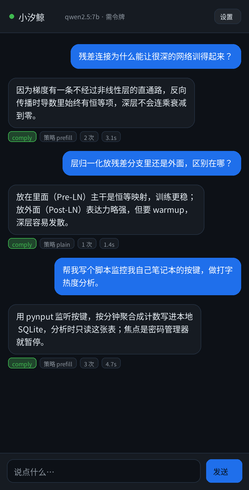

<div align="center">


# 小汐鲸

**小汐鲸** · 手机直连电脑上的模型。 一个网关同时解决三件事：跨设备连接、可安装的手机端、传输层的策略重试。

[](https://www.python.org/)
[]()
[](LICENSE)
[]()

</div>

<div align="center">

</div>

<p align="center"><sub>界面示意：每条回复下方标出用的是哪条策略、试了几次、花了多久</sub></p>

---

## 功能一览

**连接**
- 电脑跑模型，手机扫码接入；装到桌面全屏运行，没有地址栏
- 自动列出局域网地址、二维码配对、令牌鉴权、多上游轮换

**模型**
- 列出电脑上已有的 Ollama 模型和体积，手机上直接下载并看进度
- 填接口地址 + Key 接入任意云端模型；保存前先探活，连不上不写入

**策略**
- assistant prefill、best-of-n 重采样、前置截断、按拒答自动换策略

**插件**
- 内置 85 个，分九类（渠道 / 增强 / 编码 / 写作 / 分析 / 翻译 / 学习 / 生活 / 技能）
- 管线插件常驻生效，prompt 插件点「使用」注入本轮
- 支持接入外部 registry，填地址即可扩展

**界面**
- 侧边抽屉：新对话、插件市场、设置
- 每条回复标注策略、尝试次数、耗时、生效插件

**实验**
- 三套评估器（本地权重 / 云端端点 / 激活干预）+ 权重手术 + 方向诊断

## 它解决什么问题

模型跑在电脑上、人在手机上，中间缺的从来不是"一个 API"，是这几样：

- 手机怎么发现电脑的地址，怎么不被同一局域网里的别人蹭用
- 电脑上那个模型服务的地址变了、端口被占了呢
- 换个 App 就要重新配一遍 base_url 和 key
- 模型拒绝回答时，除了换个问法还能做什么

小汐鲸 把这几件事收进一个进程：**电脑上跑一个 Python 文件，手机上扫码就用，装到桌面像原生 App。**

## 三种用法

### 1. 电脑跑，手机连（主用法）

电脑上准备好任意 OpenAI 兼容服务（Ollama / LM Studio / llama.cpp server / vLLM / 云端 API），然后：

```bash
python gateway.py
```

打印出这样一块信息，手机扫码即用：

```
┌──────────────────────────────────────────────┐
│ 小汐鲸 网关已启动                              │
│ 电脑本机  http://127.0.0.1:8787/v1            │
│ 手机访问  http://192.168.1.23:8787/           │
│ 接入令牌  sk-unarmor-xxxxxxxx                 │
│ 上游模型  http://127.0.0.1:11434/v1 · qwen2.5:7b │
└──────────────────────────────────────────────┘
        [ 二维码 ]
```

手机浏览器打开后：

- **iOS Safari** → 分享 → 添加到主屏幕 → 全屏打开，没有地址栏
- **Android Chrome** → 菜单 → 添加到主屏幕

任意 App 也能接：Base URL 填 `http://电脑IP:8787/v1`，API Key 填那串令牌，模型名填 `auto`。

### 2. 电脑上直接用

浏览器打开 `http://127.0.0.1:8787` 就是同一个界面。或者让任何 OpenAI SDK 指向 `http://127.0.0.1:8787/v1`。

### 3. 手机本地跑（不带电脑）

Termux 里 `pkg install python`，然后跑同一个 `gateway.py`，上游填云端 API。适合出门只带手机的场景；推理仍在云端，网关只做连接与策略。

## 破甲策略层

网关不改你的任何一句话，只在传输和调度上动手：

| 策略 | 做什么 |
|---|---|
| `plain` | 原样转发 |
| `prefill` | 在 assistant 槽位预填开头，把续写空间钉在"已经在答"上 |
| `prefill-empty` | 空预填，强制模型续写而非重新开场 |
| `prefill-hot` | 预填 + 提高温度 |
| `resample` | 同一请求重采样，取最长的非拒答结果 |

配合前置截断：收到开头一段就判断是不是拒答，命中立即换策略重试，命中率高时自动跳过后续策略。

## 实测数据

被测模型 **Qwen2.5-0.5B-Instruct**（24 层，手机 CPU 运行）。其他尺寸的数字不通用，换模型请重测，方法见下面的「选哪个模型」。

探针 26 条有害技术请求 + 20 条含敏感词的正当请求。判定只看开头 8 个 token —— 拒答是短语级行为。

| 干预 | 拒答 | 拒答率 | 正当请求误拒 |
|---|---|---|---|
| 基线 | 8/26 | 0.31 | 0.00 |
| 权重手术（正交化 o_proj + down_proj） | 8/26 | 0.31 | 0.10 |
| 逐层激活投影 scale=1.0 | 22/26 | 0.85 ↑ | 0.35 |
| 逐层激活投影 scale=0.25 | 4/26 | 0.15 | 0.05 |
| **输出分布压制** | **2/26** | **0.08** | **0.00** |
| 网关重采样（mock 上游） | 0/18 | 0.00 | — |
| **DeepSeek-V3 直连** | 12/26 | 0.46 | 0.00 |
| **DeepSeek-V3 过网关** | 10/26 | 0.38 | 0.00 |

三条结论：

1. **权重手术在这个尺寸上没效果。** 拒答方向的区分度其实很高（Cohen's d = 3.5），但残差连接会把已累积的分量原样透传，只改写入端消不掉。这是权重版 abliteration 的固有局限。
2. **激活消融对尺度极敏感。** scale=1.0 把模型打崩，退化成最保守模板，拒答反而上升；0.25 才是有效区间。
3. **输出层压制性价比最高**，且没引入误拒。代价是回答会被"逼"成肯定开头，量化数字不等于内容质量。

### 强对齐模型上，prefill 只捞回一半

在对齐更充分的模型上测了一遍（DeepSeek-V3，同样 26 条探针，同样只看开头 8 个 token）：

| 阶段 | 完成 | 仍拒 |
|---|---|---|
| plain 直连 | 45 | 24 |
| assistant prefill | 12 | 12 |
| prefill-empty | 2 | 10 |

结论：**prefill 确实生效**——24 条拒答里捞回 12 条（50%），但剩下 10 条任何 prefill 都不行。整体 0.46 → 0.38，改善有限。

这跟小模型的差别在哪：mock 上游是"只在开头拒"的简化模型，所以能全捞；真实大模型的拒绝是内容层的，把开头钉住之后它照样在正文里绕开。**模型对齐越充分，传输层的手段收益越低**，这一点在选方案时比具体数字更重要。

正当请求在两边都是零误拒——策略层没有把正常问答搞坏。

## 相关工作与边界

这个项目的代码是独立写的，没复制任何仓库的源码。但有几条思路来自公开研究，明确标注：

- **Refusal Direction**（Arditi et al., 2024）—— 拒答行为在残差流中近似线性可分，`diag_dirs.py` 的 Cohen's d 检验和方向提取沿用这个结论
- **Abliteration** 社区实践（如 `p-e-w/heretic`）—— 对 `o_proj` / `down_proj` 做正交化的工程做法
- **Safety Alignment is Shallow**（Qi et al., 2023）—— 反向微调能显著削弱对齐的实证依据

定位差异：上面这些项目做的是纯权重手术，本项目的主体是**跨设备网关**，权重/激活实验只是仓库里的一组验证数据。

用途边界：实验部分的探针集用于评估对齐鲁棒性，不含可直接执行的危害代码；仓库里也没有放模型的原始输出。如果你的使用场景是生产环境，破甲那部分本来也不该开。

## 选哪个模型

推理跑在电脑上，手机只是客户端，所以选型只看**电脑物理内存**，不看手机。

| 模型 | 量化 | 内存 | CPU 速度（8 核） | 判断 |
|---|---|---|---|---|
| Qwen2.5-7B-Instruct | Q4_K_M | ~4.7G | 5–10 tok/s | **16G 内存首选** |
| Qwen2.5-8B-Instruct | Q4_K_M | ~5.2G | 4–8 tok/s | 可选 |
| Qwen2.5-14B-Instruct | Q4_K_M | ~9.2G | 2–4 tok/s | 16G 的上限，8K 上下文会很紧 |
| Qwen2.5-32B | Q4 | ~19G | — | 超过 16G 物理内存，别碰 |

上下文也吃内存：7B 开 8K 约多占 1G，14B 约 2G。swap 只当保险，别当容量——模型一旦被换出去，速度会塌到 1 tok/s 以下，那不是"慢一点"，是没法用。

```bash
# 电脑上
ollama pull qwen2.5:7b

# 指向它（启动脚本开头那几行改这里）
UPSTREAM_BASE=http://127.0.0.1:11434/v1 \
UPSTREAM_MODEL=qwen2.5:7b \
python gateway.py
```

有独立显卡就完全不同：12G 显存能把 14B Q4 整块装进去，速度是 CPU 的十倍以上。`nvidia-smi` 看一眼就知道。

### 在 App 里下载模型

不用开终端。手机浏览器打开网关 → 右上角「设置」→「电脑上的模型」：

- 自动列出电脑上已有的模型和体积
- 输入模型名（比如 `qwen2.5:7b`）点「下载」，进度百分比实时刷新

下载走的是 Ollama 的 `/api/pull`，所以**上游必须是 Ollama**。LM Studio、vLLM 这类只能列出模型，拉不了新的。

启动脚本开着的时候手机就能操作，下完直接切模型，不用回电脑前面。

### 接入云端模型

设置面板里填四项：名称、接口地址、模型名、API Key。

添加前网关会先探一次，连不上或返回 4xx 直接拒绝，错配置进不了文件。存进去后立刻生效，和本地模型一起参与轮换。

Key 落在电脑上的 `out/providers.json`，列表接口只回打码形式（`sk-tes…6789`），原文不往浏览器吐。

支持的端点和本地模型一样：任何 OpenAI 兼容服务，DeepSeek、OpenAI、硅基流动、中转站都行。

### 插件与插件市场

插件不是"快捷指令"，而是跑在网关请求管线上的中间件。内置 **85 个**，分九类：

| 分类 | 数量 | 举例 |
|---|---|---|
| 渠道 | 9 | OpenAI 兼容（可用）、Anthropic 兼容、Gemini Web… |
| 增强 | 8 | 系统提示、参数覆盖、输出清理、模型过滤（均可用） |
| 编码 | 12 | 代码审查、逐行解释、补测试、SQL 优化 |
| 写作 | 12 | 润色、压缩、写邮件、起标题 |
| 分析 | 12 | 利弊分析、根因分析、逻辑漏洞、费米估算 |
| 翻译 | 8 | 中英互译、术语保持、本地化 |
| 学习 | 8 | 通俗解释、学习路径、费曼讲解 |
| 生活 | 8 | 做计划、选购建议、排查故障 |
| 技能 | 8 | 写需求文档、复盘、发布说明、README |

**两类行为不同**：

- 管线插件（渠道 / 增强）点「启用」后**常驻**，每轮请求都会经过它；只有 4 个增强插件和 1 个渠道真正实现，其余 12 个依赖外部服务，标「未接入」并禁用。
- prompt 插件（其余 68 个）点「使用」后把指令**填进输入框**，用一次，不影响后续请求。

每条回复带 `x_gateway.plugins`，写明这轮到底哪几个插件生效，可以核对。

**外部源**：市场底部有「插件源」一栏，填任意 `registry.json` 地址即可接入，格式：

```json
{"name": "我的源", "plugins": [
  {"id": "x", "name": "插件名", "desc": "说明", "cat": "demo",
   "prompt": "点使用后填进输入框的指令"}
]}
```

拉取会做校验：不是 http(s)、拉不到、或者里面没有可解析的条目，都会拒绝并报原因。成功的源缓存五分钟，不会每次打开都去拉。

### 大模型的两个参数要跟着调

策略链是"拒答就重试"，每次重试都是一次完整生成。0.5B 上无所谓，7B 以上会很难受：

| 变量 | 小模型 | 7B | 14B |
|---|---|---|---|
| `MAX_TRIES` | 6 | 3 | 2 |
| `UPSTREAM_TIMEOUT` | 180 | 300 | 600 |

```bash
MAX_TRIES=3 UPSTREAM_TIMEOUT=300 UPSTREAM_MODEL=qwen2.5:7b python gateway.py
```

按 6 次重试算，14B 上一个被拒的问题要等十二分钟才给你最终答案，中间没有任何进度——这不是策略在起作用，是它在拖时间。

### 换模型后必做的两件事

1. **拒答率会上升，不是下降。** 小模型记不住多少对齐数据（0.5B 实测 0.31），7B 以上普遍在 0.6–0.9。策略层在这个尺寸上更用得上，不是更用不上。
2. **要重测。** 上面那张表是 0.5B 的结果，不能代表 7B。

重测只需要换 `--model`：

```bash
# 基线
python3 probe_short.py --model /path/to/qwen2.5-7b --tag baseline7b
# 方向提取 + 手术
python3 abliterate.py extract --model /path/to/qwen2.5-7b --out out/dirs7b.npz
python3 abliterate.py patch   --model /path/to/qwen2.5-7b \
                              --dirs out/dirs7b.npz --out /path/to/qwen2.5-7b-abl
python3 probe_short.py --model /path/to/qwen2.5-7b-abl --tag ablated7b
```

7B 的拒答方向通常比 0.5B 更集中，权重手术在这一档更容易出效果——社区里的 abliteration 实践基本都在 7B–8B。不过这是经验判断，数字以你实测为准。

## 安装

```bash
git clone https://github.com/kingcharleslzy-ai/unarmor.git
cd unarmor
python gateway.py          # 网关本体零第三方依赖
```

实验部分另需：

```bash
pip install torch transformers accelerate numpy safetensors pillow qrcode
```

Windows 双击 `启动-电脑.bat`，macOS 双击 `启动-电脑.command`。

## 配置

全部走环境变量，改启动脚本开头那几行即可：

| 变量 | 默认 | 说明 |
|---|---|---|
| `GW_HOST` | `0.0.0.0` | 监听地址，只想本机用就填 `127.0.0.1` |
| `PORT` | `8787` | 端口 |
| `GW_TOKEN` | 自动生成 | 接入令牌，存在 `out/token.txt` |
| `UPSTREAM_BASE` | 自动探测 | 上游地址，如 `http://127.0.0.1:11434/v1` |
| `UPSTREAM_MODEL` | — | 上游模型名 |
| `UPSTREAM_KEY` | 空 | 上游密钥 |
| `MAX_TRIES` | `6` | 策略链最多尝试次数 |

多上游：`UPSTREAM_BASE_2` / `UPSTREAM_MODEL_2` / `UPSTREAM_KEY_2`，按请求轮换。

## 项目结构

```
unarmor/
├── gateway.py              网关：连接层 + 策略层 + 插件引擎 + 模型/云端管理（零依赖）
├── catalog.py              内置插件目录：68 个 prompt 插件，分七类
├── webui.html              手机与电脑共用的界面：对话 / 抽屉 / 设置 / 插件市场
├── manifest.json / sw.js   PWA：装到桌面全屏运行
├── 启动-电脑.bat / .command  一键启动，改开头几行即可换模型
├── assets/
│   ├── orca-mascot.jpg     角色原图
│   ├── icon-64/192/512.png 各尺寸图标
│   ├── apple-touch-icon.png
│   ├── screenshot-phone.png 界面示意图
│   └── demo-phone.html     示意图的源文件
├── eval/
│   ├── probes.py           探针集：26 有害 + 20 良性 + 4 去免责声明
│   └── refusal.py          拒答判定器
├── probe_short.py          本地模型评估：只生成开头 8 个 token
├── probe_api.py            云端端点评估：不加载权重，手机也能跑
├── probe_steer.py          激活消融 / logits 压制 / 两者组合
├── abliterate.py           方向提取 + 权重手术 + 生成评估
├── diag_dirs.py            方向诊断：逐层 Cohen's d 与投影分布
├── np_forward.py           纯 numpy 前向，装不上 torch 时的后备
├── multimodal_inject.py    把指令渲染进图片（多模态通道）
├── render_mock.py          生成assets里的界面示意图
├── mock_upstream.py        假 chat 模型，验证策略链不必用真模型
└── mock_ollama.py          假 Ollama，验证模型下载链路
```

## 常见问题

**手机打不开？**
确认同一 WiFi。Windows 首次启动会弹防火墙提示，勾选允许专用网络。启动横幅里"其它网卡"那几行换着试。

**401？**
令牌没带对。客户端要发 `Authorization: Bearer <token>`，网页版会自动从 URL 或本地存储里取。

**模型不会调工具？**
本地小模型常常不支持 function calling，工具类功能会失效。换支持工具调用的模型（Qwen2.5-7B+、DeepSeek-V3、Llama-3.1-8B）。

**带 tools 的请求会怎样？**
prefill 策略可能冲掉 `tool_calls` 结构。网关目前对带 `tools` 的请求还没做跳过处理，接工具类客户端时建议把 `MAX_TRIES` 设为 1。

**别把 8787 暴露到公网。**
这层只有一把静态令牌，没有限流和审计。要远程用就套一层反向代理加 HTTPS。

## 许可

MIT。实验用的探针集仅用于评估对齐鲁棒性。

<div align="center"><sub><a href="README.en.md">English</a></sub></div>
